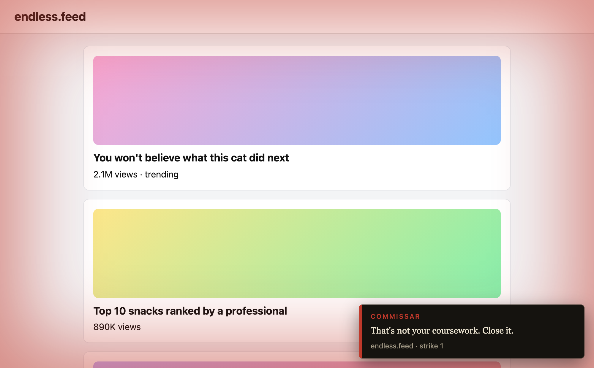
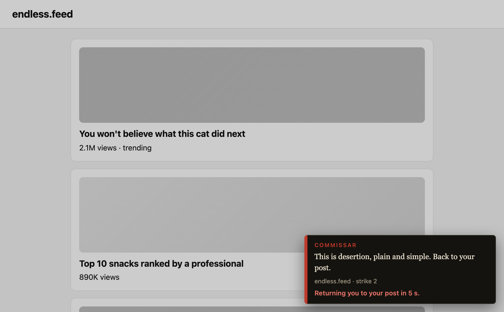
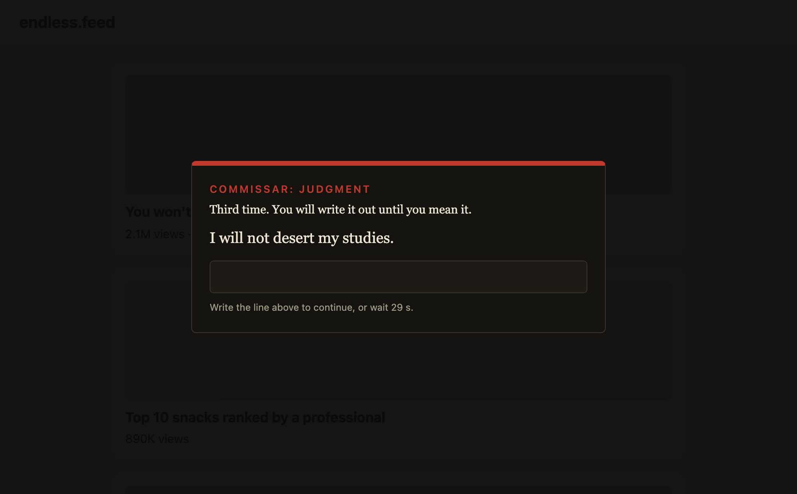
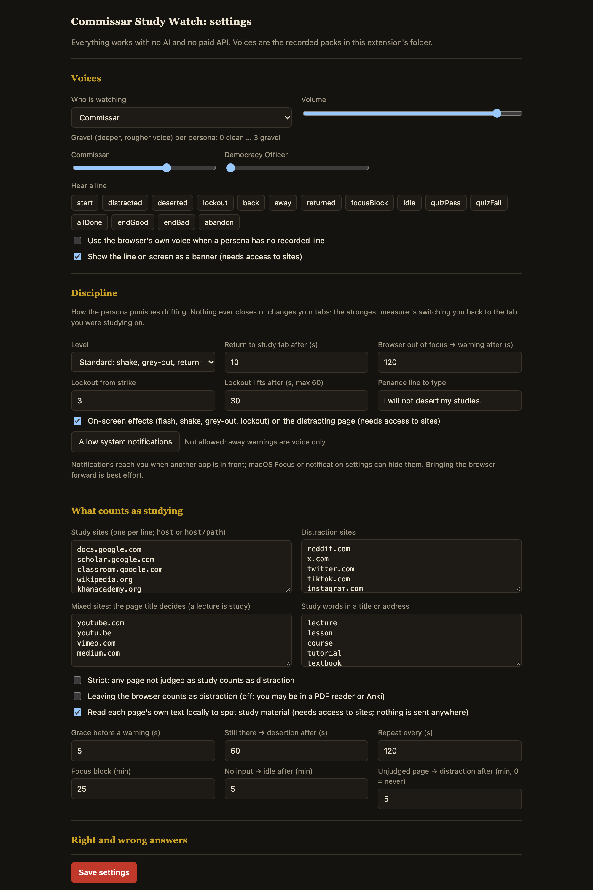

# Commissar Study Watch

A browser extension for Chrome and Brave that watches your study session and lets a stern persona keep you on task:
it notices when you drift to a distracting site, punishes you for staying there, drags you back to the tab you were
studying on, cheers right homework answers and scolds wrong ones, all in recorded voice lines.

**No AI and no paid API needed.** Everything is decided locally in your browser. Gemini is an optional extra for
pages nothing else can judge; ElevenLabs is used only by you, once, to record voice lines.

| The popup during a session | A right answer on WebAssign |
|---|---|
|  |  |

---

## Contents

- [Install](#install)
- [Your first session](#your-first-session)
- [What it reacts to](#what-it-reacts-to)
- [Discipline and punishments](#discipline-and-punishments)
- [What counts as studying](#what-counts-as-studying)
- [Right and wrong answers](#right-and-wrong-answers)
- [Voices and personas](#voices-and-personas)
- [Recording new lines with ElevenLabs](#recording-new-lines-with-elevenlabs)
- [Optional: Gemini](#optional-gemini)
- [Settings reference](#settings-reference)
- [Troubleshooting](#troubleshooting)
- [Privacy](#privacy)
- [Development](#development)
- [License and legal](#license-and-legal)

---

## Install

1. Download this repository (green **Code** button → **Download ZIP**, then unzip) or `git clone` it.
2. Open `brave://extensions` in Brave, or `chrome://extensions` in Chrome, and switch on **Developer mode**
   (top right).
3. Click **Load unpacked** and choose the folder that contains `manifest.json`.
4. Pin the extension: puzzle-piece icon in the toolbar → pin **Commissar Study Watch**.
5. Optional, recommended: open the popup and click **Allow on all sites**. This turns on the on-screen banner and
   punishment effects on any site, and lets the extension read pages locally to spot study material. Nothing is
   sent anywhere.

After you change files in the folder (or pull an update), press the reload arrow on the extension's card.

> The repository ships **without voice clips** (see [License and legal](#license-and-legal)). Until you record a pack,
> the persona speaks with the browser's own voice. Recording the full Commissar pack takes about 2,800 characters,
> inside ElevenLabs' free monthly allowance.

## Your first session

1. Click the extension icon, type what you are studying (for example *Calculus: optimization*), pick who is
   watching, and press **Begin session**.
2. Study. Open your material, your homework site, your notes.
3. Wander off to a distracting site and wait 5 seconds: the persona warns you, and the page flashes red.
4. Stay there a minute: the page greys out, shakes, and a countdown returns you to the tab you were studying on.
5. Press **End session** when you are done. Clean sessions get praise; messy ones get a report.

The badge on the icon shows the state: **ON** (on duty), **!** (distracted), **zz** (idle).

## What it reacts to

| Moment | When | Trigger |
|---|---|---|
| Session starts | You press Begin session | `start` |
| Distracted | On a distracting page for 5 s | `distracted` |
| Deserted | Still there after 60 s, then every 2 min | `deserted` |
| Lockout | Deserting again once you have 3 strikes | `lockout` |
| Back | Returned to study material after a warning | `back` |
| Unjudged drift | 5 min on a page nothing could judge | counts as `distracted` |
| Focus block | Every 25 focused minutes | `focusBlock` |
| Idle | No keyboard or mouse for 5 min | `idle` |
| Browser lost your attention | Another app in front for 2 min | `away`, then `returned` |
| Right / wrong / partly right answer | A homework answer was graded | `quizPass` / `quizFail` / `quizPartial` |
| Assignment complete | Every question correct | `allDone` |
| Session ends | Clean / messy / quit before 5 focused minutes | `endGood` / `endBad` / `abandon` |

Every number above is a setting. Leaving the browser for a PDF reader or Anki is never counted as a distraction
unless you turn that on: you only get the `away` reminder.

## Discipline and punishments

Settings → **Discipline** sets how hard the persona comes down on you.

| Level | Distracted | Deserted | Repeated desertion | Browser lost attention |
|---|---|---|---|---|
| Off | voice | voice | voice | voice |
| Lenient | red flash | red flash | red flash | voice + notification |
| **Standard** (default) | red flash | grey-out + shake + countdown, then back to your study tab | lockout from strike 3 | voice + notification |
| Harsh | red flash | as standard | lockout from the 2nd desertion | + pulls the browser window forward |

| Distracted: red flash and the warning | Deserted: grey-out and the countdown back to your post |
|---|---|
|  |  |

**Lockout.** The distracting page is covered until you type the penance line (default *I will not desert my
studies.*). It always lifts by itself within the lockout time (default 30 s, never more than 60 s), and **Esc**
lifts it after 10 seconds. Ending the session, or setting discipline to Off, removes it at once.



**What the extension never does:** it never closes, opens or navigates your tabs. The only browser control is
switching to the tab you were last studying on, and (harsh only) bringing the browser window forward. If you go
back on your own before the countdown ends, the forced return is cancelled. **Back to study tab** in the popup does
it on demand.

System notifications for the `away` reminder need one extra permission: Settings → **Allow system notifications**.
On macOS, Focus mode or the notification settings for Brave/Chrome can still hide them.

## What counts as studying

A page is judged in this order:

1. **Your study list.** `docs.google.com`, `khanacademy.org`, `webassign.net` and friends are preset.
2. **Your distraction list.** `reddit.com`, `x.com`, `tiktok.com`, `instagram.com`, `youtube.com/shorts`…
3. **Remembered verdicts**: Gemini's answer for that page, if you use Gemini.
4. **Mixed sites** (YouTube, Vimeo, Medium): the title decides. *Lecture 12: antiderivatives* is study,
   *Funny cats compilation* is not.
5. **Study words** or the words of your session subject in the title or address (*lecture*, *homework*,
   *documentation*, *.edu*, *.pdf*…).
6. **The page's own text**, read locally if you allowed all sites: study words, your subject's words, math formulas
   and "Submit answer" forms. This can only ever say "study", never "distraction".
7. Otherwise **not judged**: no penalty at first; after 5 minutes on the same such page it counts as a distraction.
   **Strict** mode makes every unjudged page a distraction at once.

In the popup, **Study site** / **Distraction** puts the current site on a list in one click. Lists accept a host
(`reddit.com`, which also covers `old.reddit.com`) or a host with a path (`youtube.com/shorts`).

## Right and wrong answers

**WebAssign is built in.** The extension reads, for every question, each part's score (`0.2/0.2`, `0/0.2`), each
part's submission count, the question's total, and the check marks. When you press **Submit Answer**, it compares
the page with how it looked a moment before and reacts to **the part you just submitted**: right → `quizPass`,
wrong → `quizFail`. Grades already on the page when you open it are ignored, and so are reloads and redraws.

**Teach any other homework or quiz site** (Settings → Right and wrong answers → *Teach a site from a saved page*):

1. On that site, open a page that already shows graded answers, and save it: **Save Page As → Webpage, Complete**.
2. In Settings, pick the saved `.html` file plus the `.css` files from its `_files` folder.
3. The extension lists what it found: the site, the marks that look like right / wrong / partial, the repeated
   question box, and the score and submission cells. **Check each one by hand** and change what is wrong.
4. **Test on the saved page** shows what the rule reads. **Save rule and allow the site** stores it and asks for
   access to that one site.

Or tick **Look for right / wrong marks on every site** to use common names (`is-correct`, `aria-label="Incorrect"`,
`data-correct`…) everywhere.

## Voices and personas

Two personas are supported out of the box (bring your own clips; see Legal):

- **Commissar** (`commissar/`): the stern officer. The **gravel** setting runs its voice through a Web Audio chain:
  slower and deeper, soft-clipped, bass and bark boosted, compressed like a shout.
- **Democracy Officer** (`helldiver/`): its starters, victory, loss and treason lines play at session start, clean
  finish, messy finish and desertion.

Pick one in the popup, or **Squad**: every line comes from a random squad member.

A pack is a folder with clips and a `manifest.json`:

```json
{ "name": "Commissar", "events": { "distracted": ["distracted-1a2b.mp3"], "quizPass": ["quizPass-9f8e.mp3"] } }
```

Event names are the triggers in [What it reacts to](#what-it-reacts-to). Packs recorded for SciEdu-Studio work too
(`on`, `tab`, `desert`, `reward`, `streak`, `streakRisk`, `quizStart`, `quizWin`, `quizLose` are used as fallbacks),
and a manifest can map triggers itself: `"aliases": {"distracted": ["myEvent"]}`. List the folder in `packs.json`.
Captions shown on screen come from `captions/<pack>.json` (the generator writes them).

## Recording new lines with ElevenLabs

The lines live in [`tools/lines/commissar.json`](tools/lines/commissar.json): 67 short lines for every trigger. Edit
them freely. Then, with your own ElevenLabs API key (Profile → API keys on elevenlabs.io):

```bash
node tools/gen-voice.mjs commissar --dry-run --replace
```

```bash
ELEVENLABS_API_KEY=your_key node tools/gen-voice.mjs commissar --only start --limit 1
```

```bash
ELEVENLABS_API_KEY=your_key node tools/gen-voice.mjs commissar --replace
```

- `--dry-run` only counts characters; nothing is sent.
- `--only start --limit 1` records one test clip.
- `--replace` makes the pack play only the lines in the file (the old list is saved as
  `manifest.before-replace.json`).
- `--max-chars` (default 3000) refuses to send more than that; already recorded lines are never paid for twice.
- `--voice <id>` uses another ElevenLabs voice; the default is the stock voice "Daniel".

Reload the extension afterwards. **Keep the key in the command or your shell, never in a file in this folder**: the
whole folder is the extension.

A new persona: copy `tools/lines/commissar.json` to `tools/lines/<name>.json`, change `name`, `voice` and the lines,
and run the generator for `<name>`. It creates the folder and adds it to `packs.json`.

## Optional: Gemini

Settings → **Gemini**, off by default. It asks only about a page that is on no list, has no study words, and that you
stayed on for 20 s; at most 40 times a day; each answer is remembered for a week; never retried automatically; never
about mail, sign-in, banking or account pages. It sends the page title, site and path (no query string), and the
start of the page text only if you tick that. The key is stored in this browser's extension storage, which web pages
cannot read. Google's free tier may use what you send to improve its products. The default model name
(`gemini-3.5-flash-lite`) is not confirmed; if Settings shows *model not found*, type the current free model name from
Google AI Studio.

## Settings reference



| Setting | Default | Range |
|---|---|---|
| Discipline | standard | off, lenient, standard, harsh |
| Return to study tab after | 10 s | 5–25 s |
| Lockout from strike | 3 | 2–10 |
| Lockout lifts after | 30 s | 10–60 s |
| Penance line | *I will not desert my studies.* | up to 80 characters |
| Browser out of focus → warning after | 120 s | 30–1800 s |
| Grace before a warning | 5 s | 0–60 s |
| Still there → desertion after | 60 s | 15–3600 s |
| Repeat every | 120 s | 30–3600 s |
| Focus block | 25 min | 5–180 min |
| No input → idle after | 5 min | 1–60 min |
| Unjudged page → distraction after | 5 min | 0 (never)–120 min |
| Gravel | Commissar 2 | 0–3 per persona |

## Troubleshooting

**Nothing happens on a distracting site.**
- Is a session running? The popup must show the timer.
- Look at **Last reaction** in the popup: it says what last triggered and whether the voice played or why it failed.
- Is the site on a list? Unknown sites only count after 5 minutes (or at once in Strict mode). Press
  **Distraction** in the popup to list it.
- No banner or effects? The extension needs **Allow on all sites** to draw on a page. Browser pages, the Web Store
  and the PDF viewer never allow it; you still get the voice.

**No reaction to a homework answer.** After reloading the extension, open WebAssign tabs get the watcher back by
themselves; if one does not, reload that tab once. Other sites need a taught rule or **Look for marks on every site**.

**No sound.** Check the volume in Settings and that the tab/browser is not muted. Without a recorded pack you get the
browser's voice; record one with the generator above.

**The lockout is stuck.** It cannot be: it lifts within its time limit (60 s at most), Esc lifts it after 10 s, and
**End session** removes it.

To see the extension's own log: `brave://extensions` → Commissar Study Watch → **Inspect views: service worker**.

## Privacy

- Everything is stored in the browser's extension storage, locked so web pages cannot read it.
- Pages are remembered by address path or a hash, never by full address with its query string.
- Homework pages report only numbers (scores, counts); answers and page text never leave the page.
- Nothing is sent anywhere unless you turn on Gemini.
- Saved homework pages hold your account details and a login session: they are git-ignored, and `npm run check`
  refuses to let one be committed. Don't zip them with the extension.

## Development

```bash
npm test
```

```bash
npm run check
```

No dependencies and no build step. The parts:

| Path | What it does |
|---|---|
| `src/core.js` | Page rules, session state machine, punishment policy, voice picking (pure, unit-tested) |
| `src/answers.js`, `src/watch.js` | Reading right / wrong answers and the local page score (runs on the page) |
| `src/sw.js`, `src/store.js` | Service worker: browser events, sessions, punishments, storage queue |
| `src/overlay.js` | Banner and effects (flash, shake, grey-out, countdown, lockout) |
| `src/audio.js`, `src/offscreen.*` | Voice playback with the gravel chain |
| `src/teach.js` | Finding marks and question structure in a saved page |
| `src/popup.*`, `src/options.*`, `src/ui.css` | Popup and settings |
| `src/gemini.js` | Optional Gemini check |
| `tools/gen-voice.mjs`, `tools/lines/` | ElevenLabs generator and line texts |
| `tools/check.mjs`, `tests/` | Static checks; unit tests and a service-worker flow test against a fake browser |

Firefox is not supported yet (no offscreen documents there); audio is behind `src/audio.js`, so a port replaces that
file. [REQUESTS.md](REQUESTS.md) records every request that shaped the project and what was built for it.

## License and legal

- Code: GNU AGPL-3.0 (see `LICENSE`). The audio chain and the voice generator are ported from SciEdu-Studio, which is
  AGPL-3.0.
- Voice clips are not distributed here. Lines you record with ElevenLabs are subject to your ElevenLabs plan's terms
  (the free plan is non-commercial and asks for attribution); a pack recorded from a game or film belongs to its
  owner: keep such packs on your own computer.
- The line texts in `tools/lines/` are original writing. The "Commissar" persona is a generic stern-officer
  character; no names, quotes or artwork from any franchise are used.
- This project is not affiliated with or endorsed by Games Workshop (Warhammer 40,000), Arrowhead Game Studios or
  Sony Interactive Entertainment (Helldivers), Cengage (WebAssign), Google (Gemini) or ElevenLabs. Their names are
  used only to describe compatibility.
