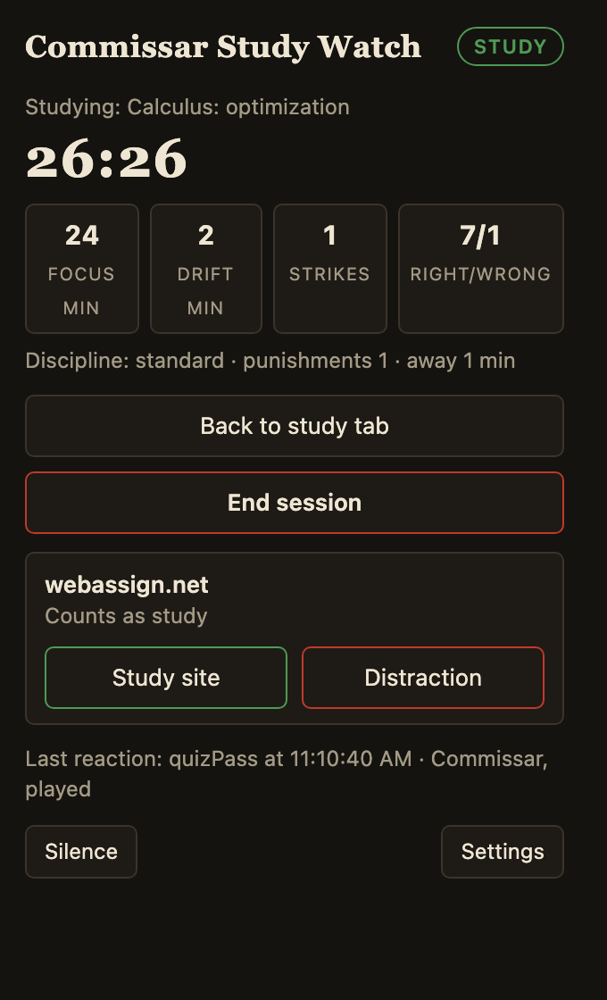
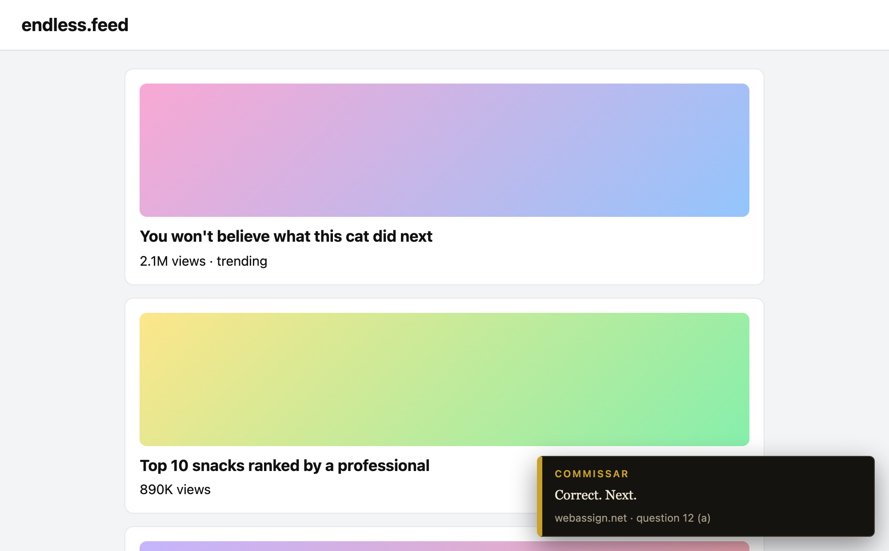
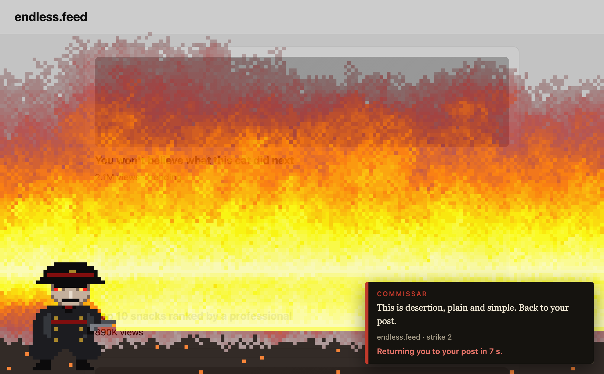
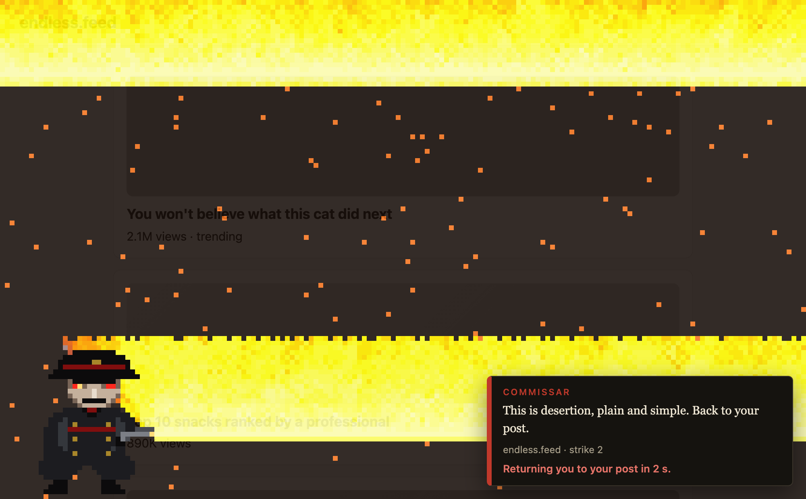
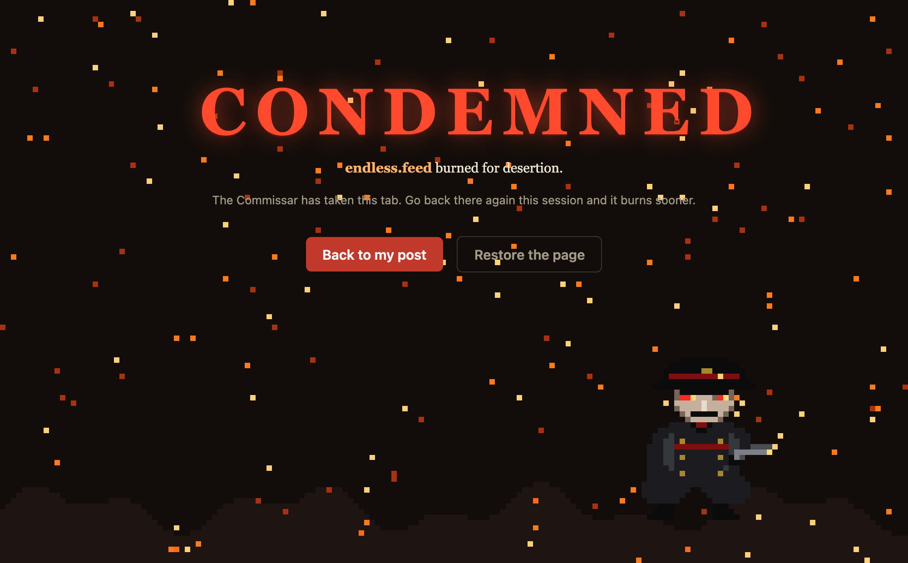
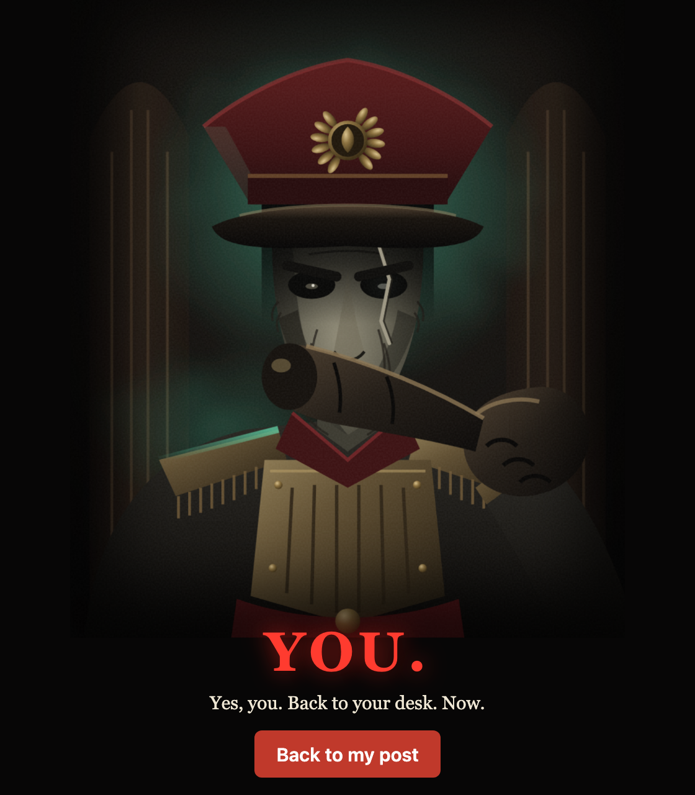
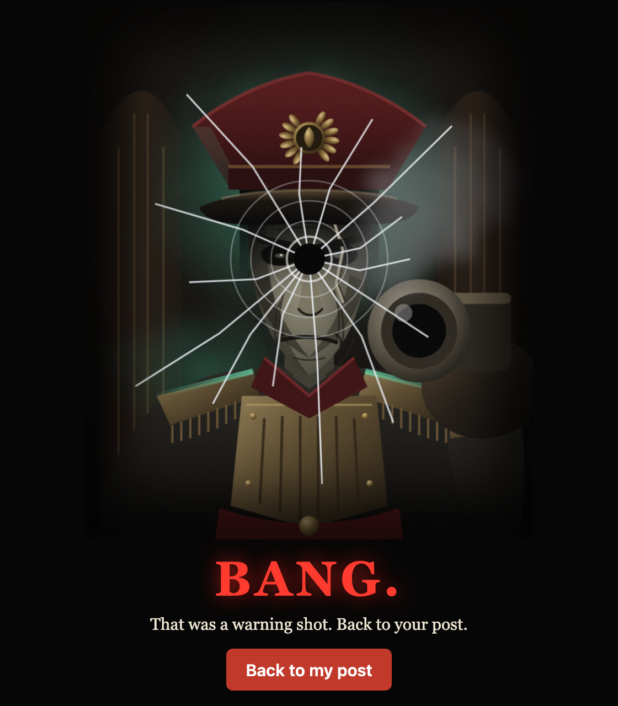
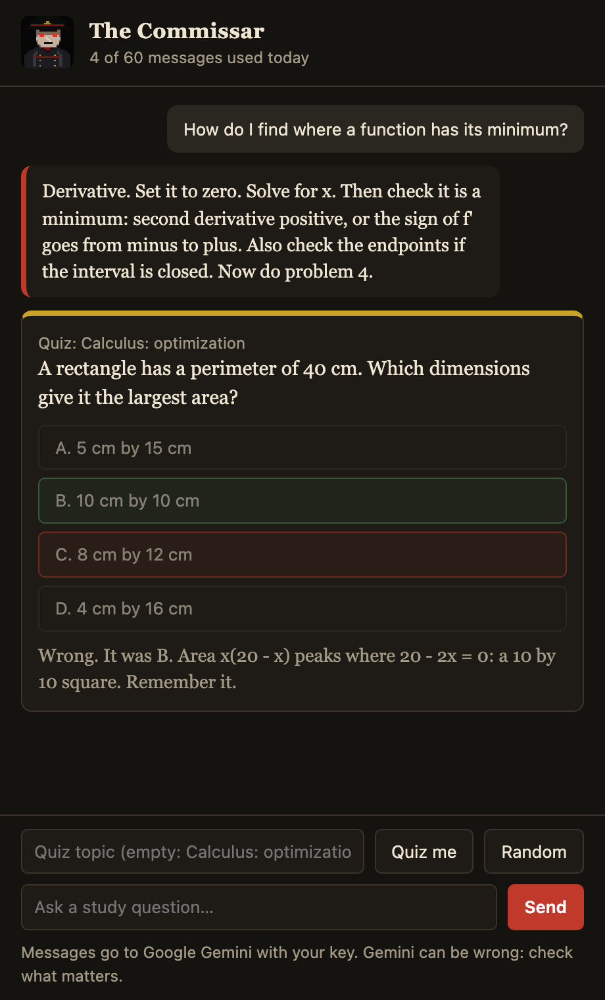

# Commissar Study Watch

A browser extension for Chrome and Brave that watches your study session and lets a stern persona keep you on task:
it notices when you drift to a distracting site, punishes you for staying there, drags you back to the tab you were
studying on, cheers right homework answers and scolds wrong ones, all in recorded voice lines.

**No AI and no paid API needed.** Everything is decided locally in your browser. Gemini is an optional extra for
pages nothing else can judge; ElevenLabs is used only by you, once, to record voice lines.

| The popup during a session | A right answer on WebAssign |
|---|---|
|  |  |

---

## Contents

- [Install](#install)
- [Your first session](#your-first-session)
- [What it reacts to](#what-it-reacts-to)
- [Discipline and punishments](#discipline-and-punishments)
- [What counts as studying](#what-counts-as-studying)
- [Right and wrong answers](#right-and-wrong-answers)
- [Voices and personas](#voices-and-personas)
- [Recording new lines with ElevenLabs](#recording-new-lines-with-elevenlabs)
- [Optional: Gemini](#optional-gemini)
- [Talk to the Commissar (Gemini)](#talk-to-the-commissar-gemini)
- [Settings reference](#settings-reference)
- [Troubleshooting](#troubleshooting)
- [Privacy](#privacy)
- [Development](#development)
- [License and legal](#license-and-legal)

---

## Install

1. Download this repository (green **Code** button → **Download ZIP**, then unzip) or `git clone` it.
2. Open `brave://extensions` in Brave, or `chrome://extensions` in Chrome, and switch on **Developer mode**
   (top right).
3. Click **Load unpacked** and choose the folder that contains `manifest.json`.
4. Pin the extension: puzzle-piece icon in the toolbar → pin **Commissar Study Watch**.
5. Optional, recommended: open the popup and click **Allow on all sites**. This turns on the on-screen banner and
   punishment effects on any site, and lets the extension read pages locally to spot study material. Nothing is
   sent anywhere.

After you change files in the folder (or pull an update), press the reload arrow on the extension's card.

> The repository includes the **Commissar** voice clips (ElevenLabs, credited in `commissar/ATTRIBUTION.md`). The
> Democracy Officer pack is not included; without a pack for a persona, it speaks with the browser's own voice. Recording the full Commissar pack takes about 3,000 characters,
> inside ElevenLabs' free monthly allowance.

## Your first session

1. Click the extension icon, type what you are studying (for example *Calculus: optimization*), pick who is
   watching, and press **Begin session**.
2. Study. Open your material, your homework site, your notes.
3. Wander off to a distracting site and wait 5 seconds: the persona warns you, and the page flashes red.
4. Stay there 20 seconds: the officer marches in and burns the page, the tab becomes the condemned page, and you are
   sent back to the tab you were studying on. Desert a second time and you also have to write your penance.
5. Press **End session** when you are done. Clean sessions get praise; messy ones get a report.

The badge on the icon shows the state: **ON** (on duty), **!** (distracted), **zz** (idle).

## What it reacts to

| Moment | When | Trigger |
|---|---|---|
| Session starts | You press Begin session | `start` |
| Distracted | On a distracting page for 5 s | `distracted` |
| Deserted | Still there after 20 s (15 s on a site already burned), then every 2 min | `deserted` |
| Hopping | Switching to another distracting tab, another app or a blank page does not reset the clock; only going back to study does (or 3 min clean) | |
| Writing punishment | The 2nd desertion of a session (harsh: the 1st) | `lockout` |
| Back | Returned to study material after a warning | `back` |
| Unjudged drift | 5 min on a page nothing could judge | counts as `distracted` |
| Focus block | Every 25 focused minutes | `focusBlock` |
| Idle | No keyboard or mouse for 5 min | `idle` |
| Browser lost your attention | Another app in front for 10 s without an outside-resources pass: pulled back | `away`, then `returned` |
| Still gone | 20 s: he points at you; 30 s: he fires, and fires again every 10 s | `awayPoint`, `awayShoot` |
| Right / wrong / partly right answer | A homework answer was graded | `quizPass` / `quizFail` / `quizPartial` |
| Assignment complete | Every question correct | `allDone` |
| Session ends | Clean / messy / quit before 5 focused minutes | `endGood` / `endBad` / `abandon` |

**I need outside resources.** A button in the popup: for 10 minutes (press again for more,
up to 30) other apps and unjudged sites are allowed, for a textbook PDF, a calculator, your notes app. Distraction
sites are still punished. He tells you when the time is up, and the away clock starts from there. **Done** ends it
early.

Every number above is a setting (except the check-ins and the outside-resources pass). Leaving the browser for a PDF reader or Anki is never counted as distracted time
unless you turn that on, but from standard up the `away` stages do pull the browser back in front (see below).

## Discipline and punishments

Settings → **Discipline** sets how hard the persona comes down on you.

| Level | Distracted | Deserted | Repeated desertion | Browser lost attention |
|---|---|---|---|---|
| Off | voice | voice | voice | voice |
| Lenient | red flash | red flash, grey-out | red flash, grey-out | voice + notification |
| **Standard** (default) | red flash | the officer burns the page, the tab becomes the condemned page, back to your study tab | burn + writing punishment (3 lines) from the 2nd desertion | switched to your study tab and the browser pulled forward, at every stage |
| Harsh | red flash | as standard | writing punishment from the 1st desertion, at least 5 lines | as standard |

| Distracted: red flash and the warning | Deserted: grey-out and the countdown back to your post |
|---|---|
|  |  |

**The burn.** On desertion a pixel-art officer marches onto the distracting page and torches it with a flamer: the
fire climbs the page and leaves it scorched black while the countdown runs, then you are sent back to your study
tab. (With *reduce motion* on in your system settings you get one still frame instead.)

| He opens fire | The page burns out |
|---|---|
|  |  |

**The tab burns.** When the countdown ends, the distracting page is replaced by a **condemned** page (ashes, embers,
the officer standing in them) and you are sent to your study tab. Nothing is closed: Back, or *Restore the page*,
brings the page back. Go back to a burned site in the same session and it burns again after only 15 seconds.



**His post (the watch window).** macOS does not let an app in the background bring its windows in front of the app
you are using, so a screamer window opened while you are elsewhere would stay hidden behind it. Nothing of his stays on
top of your apps: with the **Mac helper** the screamers reach you over any app, and without it they meet you when you
come back to the browser. Only with the **camera watch** on does a small **Commissar's post** window open when a
session starts: press **Post the Commissar** and the camera runs from a small picture-in-picture window (that is what
keeps it running), which stays on top of your apps. The post window then minimizes itself.

**It slides behind an app?** That app is fullscreen: macOS gives a fullscreen app its own Space, and a
window that is always on top stays on top only in its own Space. Use the Mac helper (below), or the app in a maximized window (Option-click the green button), or
stay in the browser; out of the browser for 10 s brings the warnings either way. Using his watch window itself for
longer than 10 s may also count as out of the browser.

**Screamers.** After twice the warning time (20 s by default) out of the browser, the officer lunges at you from his
watch window, pointing: **YOU.** After three times (30 s) he aims his pistol and fires: a muzzle flash, a gunshot,
and a bullet hole cracked across the window, and he fires again every 10 s until you come back. Without the watch
window they open in a window of their own, which macOS may keep hidden, so **when you come back to the browser the
screamer meets you there** too. **Back to my post** takes you to your study tab. On at standard and harsh; switch
them off in Settings. With *reduce motion* on there is no lunge and no white flash.

**Use your own pictures (private).** Put images named `scare-point`, `scare-shoot` (or just `scare`) with a `.png`,
`.jpg` or `.webp` extension into a folder called `custom/` inside the extension folder. The screamer then shows your
picture with the lunge, shake, flash, smoke and bullet hole on top. `custom/` is git-ignored: whatever you put there
stays on your computer and is never published.

| He points at you | He fires |
|---|---|
|  |  |

**Writing punishment.** The burning page is covered and its video paused until you type the penance line (default
*I will not desert my studies.*) by hand, 3 times (harsh: 5), pressing Enter after each. No pasting, no Esc, no
timer. The writing box is a page of the extension laid over the site, so the site never sees your keys: YouTube's
shortcuts cannot eat them. Reloading the page or opening another distraction does not get you out: the penance is
owed until it is written, and every distracting page you open is locked again. When it is written, the tab burns and
you are sent back to your post. The only other ways out are closing the tab and studying, or **End session**
(which counts against you).


**What the extension never does:** it never closes your tabs or opens new ones (except its own screamer and chat
windows). The browser control is: switching to the tab you were last studying on, turning a burned tab into the
condemned page (Back restores it), and bringing the browser window forward (standard and harsh). If no study tab is
remembered, it switches to the most recently used open tab that counts as study. If you go
back on your own before the countdown ends, the forced return is cancelled. **Back to study tab** in the popup does
it on demand.

System notifications for the `away` warnings are on (the permission is part of the extension). On macOS, Focus mode
or the notification settings for Brave/Chrome can still hide them: allow them in System Settings → Notifications.

**Check-ins.** While you are in the browser he peeks in from an edge of the page every 1 to 5 minutes, at random:
*I am watching you.* This is not a setting.

## Mac helper: over fullscreen apps, and which app you are in

A browser cannot draw over a fullscreen app (macOS gives it its own Space) and cannot see which app you switched to.
A small helper app on your Mac can. It is optional, and the source is [native/CommissarOverlay.swift](native/CommissarOverlay.swift).
- **On top of everything:** the screamers show over every app and every Space, fullscreen apps included.
- **The app in front:** it tells the extension the name of the app in front, and nothing else: no window titles,
  no screen contents. Settings has two lists, matched against any part of the app's name or bundle id:
  - **Study apps** (Preview and PDF readers, Anki, Notion, Obsidian, Word, Pages, Notes, Calculator, code
    editors…) count as studying.
  - **Distraction apps** (Telegram, WhatsApp, Discord, Messages, Steam, Music, TV…) bring the out-of-browser
    punishments after 3 s.
  - **Any other app** gets the usual 10 s.
- **Brings the browser back:** macOS 14 and later ignore a browser in the background asking to come forward. When
  he pulls you back, the helper brings the browser to the front for it.
- **Nothing stays on screen:** between screamers the helper shows nothing and uses about 0% CPU. A screamer uses a
  web view that is closed again when it ends.
- **Test the helper** in Settings → Mac helper: it starts the helper and shows him over your screen for 3 seconds.

**Install** (macOS, with Apple's command line tools: `xcode-select --install`). Settings → **Mac helper** shows
this command with your extension's id filled in. Run it in the extension folder:

```bash
node tools/install-overlay.mjs <your-extension-id>
```

It builds the helper, copies it to `~/Library/Application Support/CommissarOverlay/` (so later changes to this
folder never change what the browser runs) and registers it with Brave for that extension only. Its panels cannot
load anything from the internet. `--browser chrome`
registers it with Chrome instead, and `--uninstall` removes it. Then tick **Use the Mac helper** in Settings and allow
the one permission it asks for (talking to the helper). It starts with each session and quits when the session ends.
After updating the extension, run the install command again to get the new helper (an old helper still works).

## Camera watch (on this computer only)

Settings → **Camera watch**, off by default. During a session the camera is checked about once a second, on your
computer, by Google's MediaPipe: the object detector (EfficientDet-Lite2, the labels *person* and *cell phone*, with a
second, zoomed look at the area in front of you when the whole picture shows no phone) and the face
landmarker (which way your head and eyes point). No picture is saved or sent anywhere; the extension only learns
*phone yes/no, person yes/no, looking at the screen / down / away*.

**Where it runs.** When you post the Commissar in his watch window, the camera runs there: that window can ask for
the camera and is on screen, so it is never slowed down. Otherwise it runs in the background, which only works when
the camera is allowed for good: if Brave asks how long to remember the camera, pick the longest.

| The camera sees | What happens |
|---|---|
| A phone in view for 3 s (in 3 of 4 looks, at a confident score) | A strike, the red flash, and he points at you: *"Put the phone down. Now."* |
| Still on it 30 s later | He fires, a strike and a desertion (the next desertion brings the writing punishment), and again every 30 s while the phone stays |
| An empty chair for 90 s | *"An empty chair. Where is my soldier?"* and a notification |
| You at the desk, off your phone, but no keyboard or mouse | You are reading: not idle |
| Looking away from the screen for 8 s (judged against where you usually look, so the camera may sit to one side) | *"Eyes front."* and the flash; 60 s: a strike and he points at you |
| Head down with the keyboard and mouse untouched for 20 s | *"A phone in your lap? Put it away."*; at 3× the time: a strike. Writing on paper: take an outside-resources pass first |

**Setting it up:**

```bash
npm run vision
```

This fetches the detector (about 31 MB: MediaPipe Tasks Vision 1.2.3 from npm, and the model from Google; both
Apache-2.0, checksums pinned in [tools/get-vision.mjs](tools/get-vision.mjs)) into `vendor/`, which is not in git.
Reload the extension, tick **Watch through the camera during sessions**, and allow the camera when asked. **Test it**
shows the camera with boxes around what it recognizes, without counting anything.

Limits: it can only see a phone the camera can see (not one held under the desk), and the camera light stays on
during sessions. The page that runs it allows WebAssembly (`'wasm-unsafe-eval'` in the manifest), which the detector
needs; no remote code is ever loaded.

## What counts as studying

A page is judged in this order:

1. **Your study list.** `docs.google.com`, `khanacademy.org`, `webassign.net` and friends are preset.
2. **Your distraction list.** `reddit.com`, `x.com`, `tiktok.com`, `instagram.com`, `youtube.com/shorts`…
3. **Remembered verdicts**: Gemini's answer for that page, and the sites it learned (below), if you use Gemini.
4. **Mixed sites** (YouTube, Vimeo, Medium): the title decides. *Lecture 12: antiderivatives* is study,
   *Funny cats compilation* is not.
5. **Study words** or the words of your session subject in the title or address (*lecture*, *homework*,
   *documentation*, *.edu*, *.pdf*…).
6. **The page's own text**, read locally if you allowed all sites: study words, your subject's words, math formulas
   and "Submit answer" forms. This can only ever say "study", never "distraction".
7. Otherwise **not judged**: no penalty at first; after 5 minutes on the same such page it counts as a distraction.
   **Strict** mode makes every unjudged page a distraction at once.

In the popup, **Study site** / **Distraction** puts the current site on a list in one click. Lists accept a host
(`reddit.com`, which also covers `old.reddit.com`) or a host with a path (`youtube.com/shorts`).

## Right and wrong answers

**WebAssign is built in.** The extension reads, for every question, each part's score (`0.2/0.2`, `0/0.2`), each
part's submission count, the question's total, and the check marks. When you press **Submit Answer**, it compares
the page with how it looked a moment before and reacts to **the part you just submitted**: right → `quizPass`,
wrong → `quizFail`. Grades already on the page when you open it are ignored, and so are reloads and redraws.

**Teach any other homework or quiz site** (Settings → Right and wrong answers → *Teach a site from a saved page*):

1. On that site, open a page that already shows graded answers, and save it: **Save Page As → Webpage, Complete**.
2. In Settings, pick the saved `.html` file plus the `.css` files from its `_files` folder.
3. The extension lists what it found: the site, the marks that look like right / wrong / partial, the repeated
   question box, and the score and submission cells. **Check each one by hand** and change what is wrong.
4. **Test on the saved page** shows what the rule reads. **Save rule and allow the site** stores it and asks for
   access to that one site.

Or tick **Look for right / wrong marks on every site** to use common names (`is-correct`, `aria-label="Incorrect"`,
`data-correct`…) everywhere.

## Voices and personas

Two personas are supported out of the box (the Commissar's clips are included; the Democracy Officer's are not):

- **Commissar** (`commissar/`): the stern officer. The **gravel** setting runs its voice through a Web Audio chain:
  slower and deeper, soft-clipped, bass and bark boosted, compressed like a shout.
- **Democracy Officer** (`helldiver/`): its starters, victory, loss and treason lines play at session start, clean
  finish, messy finish and desertion.

Pick one in the popup, or **Squad**: every line comes from a random squad member.

A pack is a folder with clips and a `manifest.json`:

```json
{ "name": "Commissar", "events": { "distracted": ["distracted-1a2b.mp3"], "quizPass": ["quizPass-9f8e.mp3"] } }
```

Event names are the triggers in [What it reacts to](#what-it-reacts-to). Packs recorded for SciEdu-Studio work too
(`on`, `tab`, `desert`, `reward`, `streak`, `streakRisk`, `quizStart`, `quizWin`, `quizLose` are used as fallbacks),
and a manifest can map triggers itself: `"aliases": {"distracted": ["myEvent"]}`. List the folder in `packs.json`.
Captions shown on screen come from `captions/<pack>.json` (the generator writes them).

## Recording new lines with ElevenLabs

The lines live in [`tools/lines/commissar.json`](tools/lines/commissar.json): about 100 short lines for every
trigger, among them a set in the voice of an old siege commissar who held a city through an endless horde (*"I held a
city for a year with cooks and clerks. You will hold this desk for one hour."*). They are original lines, not quotes
from any game or book. Edit them freely. Then, with your own ElevenLabs API key (Profile → API keys on elevenlabs.io):

```bash
node tools/gen-voice.mjs commissar --dry-run --replace
```

```bash
ELEVENLABS_API_KEY=your_key node tools/gen-voice.mjs commissar --only start --limit 1
```

```bash
ELEVENLABS_API_KEY=your_key node tools/gen-voice.mjs commissar --replace
```

- `--dry-run` only counts characters; nothing is sent.
- `--only start --limit 1` records one test clip.
- `--replace` makes the pack play only the lines in the file (the old list is saved as
  `manifest.before-replace.json`).
- `--max-chars` (default 4000) refuses to send more than that; already recorded lines are never paid for twice.
- `--voice <id>` uses another ElevenLabs voice; the default is the stock voice "Daniel".

Reload the extension afterwards. **Keep the key in the command or your shell, never in a file in this folder**: the
whole folder is the extension.

**Free and local, with VoiceStudio.** With the VoiceStudio app (OmniVoice) open on this Mac, no key is needed:

```bash
node tools/gen-voice.mjs commissar --engine voicestudio --as commissar-local
```

- `--as commissar-local` writes a separate pack, "Commissar (VoiceStudio)", that you pick in Settings; the ElevenLabs
  pack is left alone.
- Without `--voice`, the voice is designed from `--instruct` (default `male, middle-aged, low pitch, russian accent`;
  OmniVoice only accepts its own words such as `elderly`, `very low pitch`, `british accent`), and a fixed `--seed`
  keeps every line the same man. `--voice <profile id>` uses a voice you cloned or designed in VoiceStudio;
  `--list-voices` lists them. `--speed` 0.25–4.
- It talks to `http://127.0.0.1:3900` (override with `VOICESTUDIO_URL`); there is no character cap.

A new persona: copy `tools/lines/commissar.json` to `tools/lines/<name>.json`, change `name`, `voice` and the lines,
and run the generator for `<name>`. It creates the folder and adds it to `packs.json`.

## Optional: Gemini

Settings → **Gemini**, off by default. It asks only about a page that is on no list, has no study words, and that you
stayed on for 20 s; at most 40 times a day; each answer is remembered for a week; never retried automatically; never
about mail, sign-in, banking or account pages. It sends the page title, site and path (no query string), and the
start of the page text only if you tick that. The key is stored in this browser's extension storage, which web pages
cannot read. Google's free tier may use what you send to improve its products. The default model name
(`gemini-3.5-flash-lite`) is not confirmed; if Settings shows *model not found*, type the current free model name from
Google AI Studio.

**Sites the AI learned.** With Gemini on and a key saved, every new site you open is sorted once, after 4 s on it:
**study**, **distraction** or **neutral** (search, mail, tools), with a short reason. It judges the site, not each
page, so a site costs one call ever (at most 100 new sites a day). Sites on your own lists are never asked about, and
your lists always win. Settings → **Sites the AI learned** shows the table: change a verdict and it becomes yours,
**Save as file** writes it all to a `.json` file, **Load a file** brings one back (another browser, a friend's list),
**Forget all** clears it. A learned neutral site never drifts into a distraction; study words in a page title still
count as study. Tick *send the start of the page text* to let it read the page as well.

## Talk to the Commissar (Gemini)

With your Gemini key set up (Settings → Gemini), **Talk to the Commissar** in the popup opens a chat window:

- **Ask study questions**: he answers correctly first, then pushes you back to work. He is an original character and
  keeps it short.
- **Quiz me**: one multiple-choice question on the topic you type, or on your session subject. **Random** picks a
  topic (calculus, physics, history…). Your answer is graded on the spot, his voice reacts like to a homework answer,
  and a running session counts it in right/wrong.
- At most 60 messages a day by default (Settings), to protect your free quota. Replies can be read aloud with the
  browser voice. Messages go to Google with your key; Gemini can be wrong.



## Settings reference

Settings save by themselves a moment after you change them, the Gemini key included ("Saved automatically" at
the bottom). They are kept in the browser's extension storage, which survives reloading the extension and restarting
the browser; removing the extension clears it.


| Setting | Default | Range |
|---|---|---|
| Discipline | standard | off, lenient, standard, harsh |
| Burn, then back to study tab after | 6 s | 3–25 s |
| Burn the tab (condemned page) | on | on / off |
| Writing punishment from desertion no. | 2 (harsh: 1) | 1–10 |
| Write the penance this many times | 3 (harsh: at least 5) | 1–10 |
| Screamers when out of the browser | on | on / off |
| Penance line | *I will not desert my studies.* | up to 80 characters |
| Out of the browser → pulled back after | 10 s | 5–1800 s |
| Grace before a warning | 5 s | 0–60 s |
| Still there → desertion after | 20 s | 15–3600 s |
| Repeat every | 120 s | 30–3600 s |
| Focus block | 25 min | 5–180 min |
| No input → idle after | 5 min | 1–60 min |
| Unjudged page → distraction after | 5 min | 0 (never)–120 min |
| Gravel | Commissar 2 | 0–3 per persona |

## Troubleshooting

**Nothing happens on a distracting site.**
- Is a session running? The popup must show the timer.
- Look at **Last reaction** in the popup: it says what last triggered and whether the voice played or why it failed.
- Is the site on a list? Unknown sites only count after 5 minutes (or at once in Strict mode). Press
  **Distraction** in the popup to list it.
- No banner or effects? The extension needs **Allow on all sites** to draw on a page. Browser pages, the Web Store
  and the PDF viewer never allow it; you still get the voice.

**No reaction to a homework answer.** After reloading the extension, open WebAssign tabs get the watcher back by
themselves; if one does not, reload that tab once. Other sites need a taught rule or **Look for marks on every site**.

**No sound.** Check the volume in Settings and that the tab/browser is not muted. Without a recorded pack you get the
browser's voice; record one with the generator above.

**The writing punishment won't go away.** That is the point: write the line the number of times shown and press
Enter after each. Closing the tab or **End session** also removes it; discipline Off or Lenient cancels it.

**Bringing the browser forward does nothing.** macOS may refuse to let an app jump in front of the one you are using.
The window still flashes in the Dock, the study tab is already switched in, and the screamer windows open on top.

**Settings saved before this version** with the old timings (30 s desertion, 8 s countdown, 2 min away) are moved
to the new ones (20 s, 6 s, 10 s out of the browser). Values you changed yourself are kept.

To see the extension's own log: `brave://extensions` → Commissar Study Watch → **Inspect views: service worker**.

## Privacy

- Everything is stored in the browser's extension storage, locked so web pages cannot read it.
- Pages are remembered by address path or a hash, never by full address with its query string.
- Homework pages report only numbers (scores, counts); answers and page text never leave the page.
- The camera watch (off by default) runs on your computer only: no picture is saved or sent.
- Nothing is sent anywhere unless you turn on Gemini. With it on, each new site's title and address (and the start
  of its text if you tick that) goes to Google once, to sort the site.
- Saved homework pages hold your account details and a login session: they are git-ignored, and `npm run check`
  refuses to let one be committed. Don't zip them with the extension.

## Development

```bash
npm test
```

```bash
npm run check
```

No dependencies and no build step. The parts:

| Path | What it does |
|---|---|
| `src/core.js` | Page rules, session state machine, punishment policy, voice picking (pure, unit-tested) |
| `src/answers.js`, `src/watch.js` | Reading right / wrong answers and the local page score (runs on the page) |
| `src/sw.js`, `src/store.js` | Service worker: browser events, sessions, punishments, storage queue |
| `src/overlay.js` | Banner and effects (flash, shake, grey-out, pixel-art burn, countdown, writing-punishment frame) |
| `src/penance.*` | The writing punishment, in an extension frame over the page so the page never sees your keys |
| `src/post.*` | His post: the always-on-top picture-in-picture watch window where the screamers play |
| `src/vision.js`, `src/camera.js`, `tools/get-vision.mjs` | The camera watch: on-device detection in the offscreen document; fetching the detector |
| `native/`, `src/native.js`, `src/native-html.js`, `tools/install-overlay.mjs` | The Mac helper: over fullscreen apps, the app in front |
| `src/pixelart.js`, `src/scare*.js`, `src/scare.html` | The officer's pixel art (burn); the illustrated screamer scenes |
| `src/audio.js`, `src/offscreen.*` | Voice playback with the gravel chain |
| `src/teach.js` | Finding marks and question structure in a saved page |
| `src/popup.*`, `src/options.*`, `src/ui.css` | Popup and settings |
| `src/gemini.js`, `src/chat.*` | Optional Gemini: page check, chat and quizzes |
| `tools/gen-voice.mjs`, `tools/lines/` | ElevenLabs generator and line texts |
| `tools/check.mjs`, `tests/` | Static checks; unit tests and a service-worker flow test against a fake browser |

Firefox is not supported yet (no offscreen documents there); audio is behind `src/audio.js`, so a port replaces that
file. [REQUESTS.md](REQUESTS.md) records every request that shaped the project and what was built for it.

## Font

Every page, banner and panel uses **JetBrains Mono**, the font of &.edu. It is bundled in [src/fonts/](src/fonts/)
(Latin and Cyrillic, regular and bold, and italic; about 100 KB), so it works offline and no page asks Google for it.
JetBrains Mono is © The JetBrains Mono Project Authors, under the SIL Open Font License 1.1
([src/fonts/OFL.txt](src/fonts/OFL.txt)).

## License and legal

- Code: GNU AGPL-3.0 (see `LICENSE`). The audio chain and the voice generator are ported from SciEdu-Studio, which is
  AGPL-3.0.
- The Commissar voice clips in `commissar/` were generated with ElevenLabs (stock voice "Daniel") and are shared for
  non-commercial use with credit to ElevenLabs (see `commissar/ATTRIBUTION.md`); they are not under the AGPL. Lines
  you record yourself follow your own ElevenLabs plan's terms. A pack recorded from a game or film belongs to its
  owner: keep such packs on your own computer.
- The line texts in `tools/lines/` are original writing. The "Commissar" persona is a generic stern-officer
  character; no names, quotes or artwork from any franchise are used.
- This project is not affiliated with or endorsed by Games Workshop (Warhammer 40,000), Arrowhead Game Studios or
  Sony Interactive Entertainment (Helldivers), Cengage (WebAssign), Google (Gemini) or ElevenLabs. Their names are
  used only to describe compatibility.
